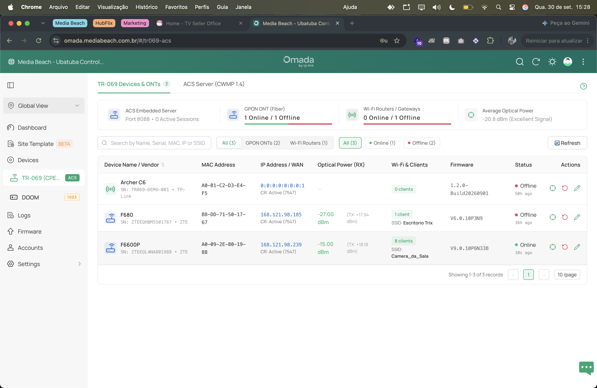
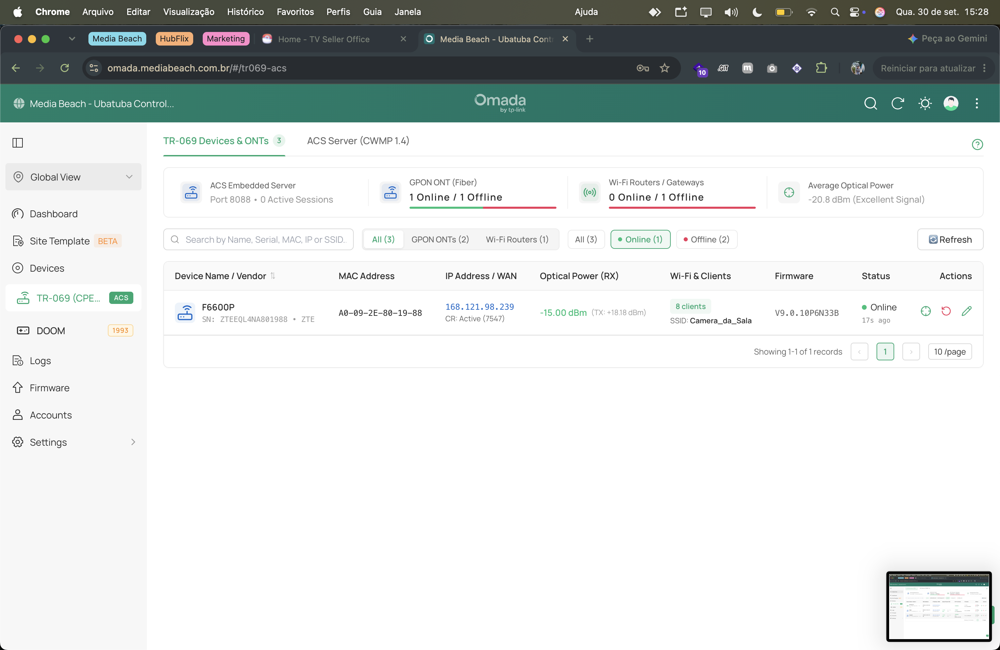
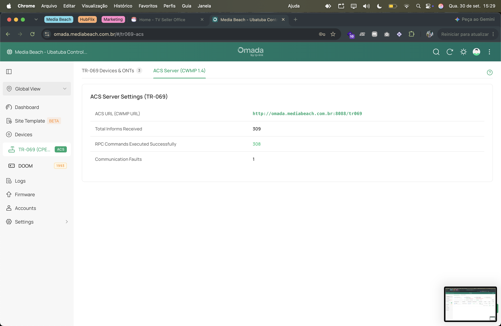
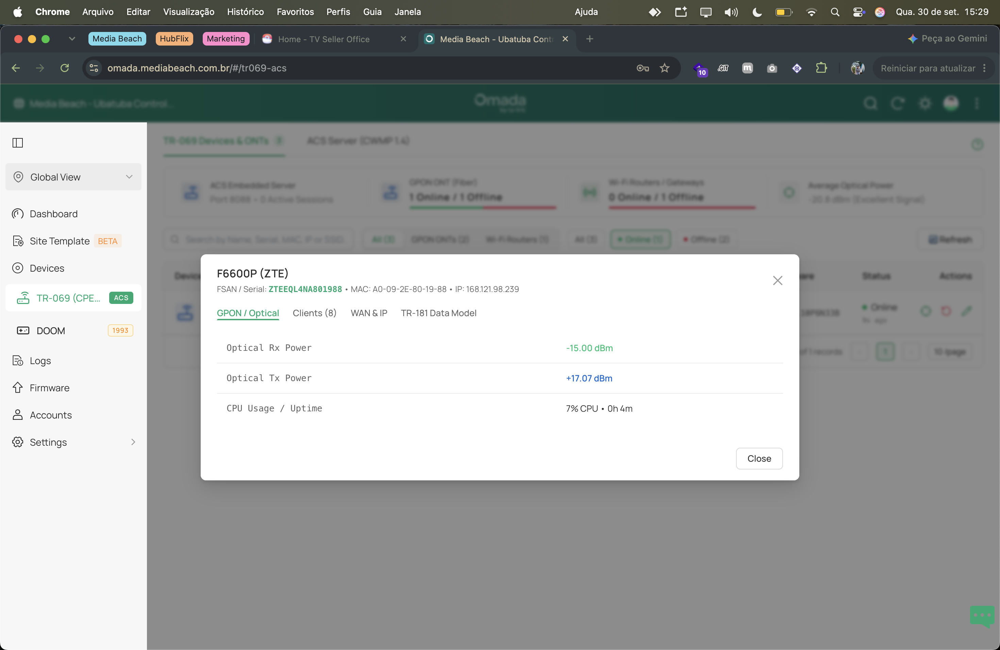
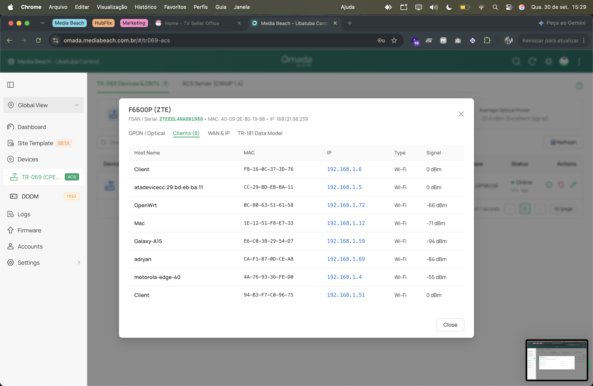
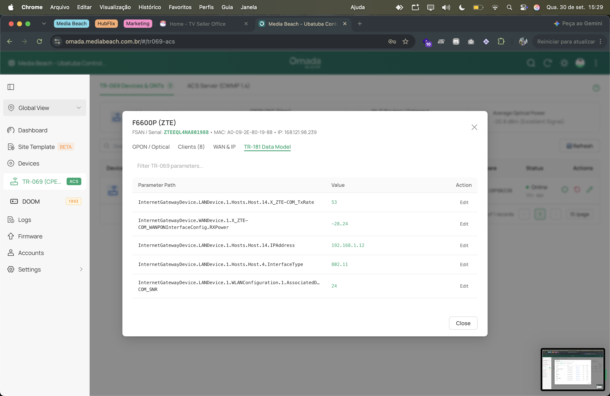
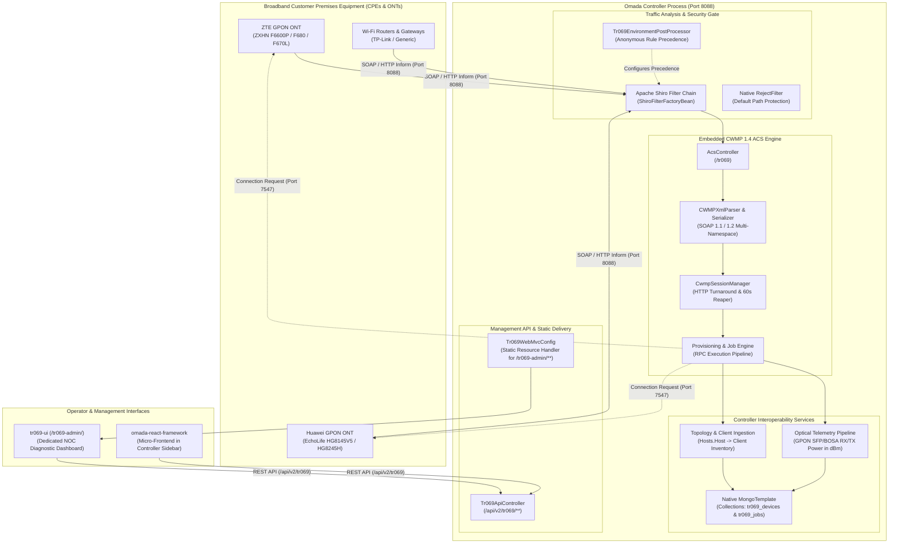

# Enterprise SDN Interoperability: Native CWMP (TR-069) ACS & UI Module for TP-Link Omada Controller

An independent technical research project and production-ready extension implementing an in-process **Auto Configuration Server (ACS)** and management plane based on **CWMP standards (TR-069, TR-181, and TR-098)** designed to operate natively within the **TP-Link Omada SDN Controller (v6.3+)**.

The system enables enterprise operators and Internet Service Providers (ISPs) to manage broadband customer premises equipment (**GPON / EPON ONTs and Wi-Fi routers**) directly through the Omada Controller without relying on external, disconnected ACS instances.

---

## 📸 Interface Preview & Visual Diagnostics

The embedded management console provides real-time optical diagnostics, remote provisioning, and telemetry monitoring:

<p align="center">
  
  
</p>
<p align="center">
  
  
</p>
<p align="center">
  
  
</p>

---

## 1. System Architecture Overview

The integration operates directly within the controller's Java Virtual Machine (JVM) process, sharing native persistence, security filter chains, and web presentation layers:



---

## 2. Loading and Lifecycle Mechanism

The module is loaded natively by the host controller across four distinct phases:

### 2.1. Linux Daemon Bootstrap & Classpath Wildcard Ingestion
The Omada Controller runs on Linux as a background daemon managed by Apache Commons Daemon (`jsvc`), defined in `/opt/tplink/EAPController/bin/control.sh`:

```bash
JSVC_OPTS="${JSVC_OPTS}\
 -pidfile ${PID_FILE} \
 -home ${JRE_HOME} \
 -cp /usr/share/java/commons-daemon.jar:${OMADA_HOME}/lib/*:${OMADA_HOME}/properties \
 -outfile ${LOG_DIR}/startup.log \
 -errfile ${LOG_DIR}/startup.log \
 -user ${OMADA_USER} \
 -procname ${NAME} \
 ${JAVA_OPTS}"
```

**Key Execution Factors:**
- **Classpath Wildcard (`${OMADA_HOME}/lib/*`)**: The Java Virtual Machine specification resolves the directory wildcard by mounting every `.jar` file located inside `/opt/tplink/EAPController/lib/` directly into the system `AppClassLoader`.
- When `omada-tr069-plugin-1.0.0.jar` is copied to this directory and file ownership is assigned to user `omada`, its bytecode and `META-INF` descriptor trees become immediately accessible to the JVM at startup without requiring modifications to the main executable launcher (`com.tplink.smb.omada.starter.OmadaLinuxMain`).

### 2.2. Dual-Standard Spring Boot SPI Registration
To maintain complete compatibility across both legacy and modern Spring Boot environments, the module declares its configuration entry points using two complementary standards:

1. **Modern Spring Boot 2.7+ / 3.x SPI**:
   - Declared in `META-INF/spring/org.springframework.boot.autoconfigure.AutoConfiguration.imports`:
     ```
     com.openomada.plugin.tr069.config.Tr069AutoConfiguration
     ```
   - Automatically scanned by `AutoConfigurationImportSelector`.

2. **Standard Spring Factories SPI**:
   - Declared in `META-INF/spring.factories`:
     ```properties
     org.springframework.boot.autoconfigure.EnableAutoConfiguration=\
       com.openomada.plugin.tr069.config.Tr069AutoConfiguration

     org.springframework.boot.env.EnvironmentPostProcessor=\
       com.openomada.plugin.tr069.config.Tr069EnvironmentPostProcessor
     ```

### 2.3. Qualified Bean Isolation & Conflict Prevention
To avoid naming collisions with internal controller components (such as Apache Shiro's `sessionManager` and `securityManager`), all plugin beans are defined with qualified identifiers:
- `cwmpSessionManager` (`CwmpSessionManager`)
- `cwmpParameterCache` (`ParameterCache`)
- `cwmpMetrics` (`CwmpMetrics`)
- `cwmpDeviceRepository` (`Tr069DeviceRepository`)
- `cwmpJobRepository` (`Tr069JobRepository`)
- `cwmpTelemetryPipeline` (`TelemetryPipeline`)
- `cwmpJobEngine` (`JobEngine`)
- `cwmpProvisioningEngine` (`ProvisioningEngine`)
- `cwmpConnectionRequestService` (`ConnectionRequestService`)
- `cwmpOmadaIntegrationService` (`OmadaIntegrationService`)

### 2.4. Native MongoDB Ingestion via `@Lazy MongoTemplate`
Instead of creating redundant database connection pools or running a separate MongoDB instance, the module injects the controller's active `MongoTemplate` bean lazily:
```java
@Bean(name = "tr069DeviceRepository")
@ConditionalOnMissingBean(Tr069DeviceRepository.class)
public Tr069DeviceRepository tr069DeviceRepository(@Autowired(required = false) @Lazy MongoTemplate mongoTemplate) {
    return new Tr069DeviceRepository(mongoTemplate);
}
```
This guarantees that data is written directly to the host controller's local MongoDB instance under the dedicated collections `tr069_devices` and `tr069_jobs`.

---

## 3. Communication Analysis & Security Layer (Apache Shiro)

The Omada Controller employs an **Apache Shiro** filter chain to govern incoming HTTP traffic. Unmapped endpoints are dropped by a strict fallback filter (`RejectFilter`) returning `HTTP 404`.

### 3.1. Environment Post-Processing via SPI
To ensure CWMP device traffic and management endpoints pass through without hindrance, the module implements `org.springframework.boot.env.EnvironmentPostProcessor`:

**Class:** `com.openomada.plugin.tr069.config.Tr069EnvironmentPostProcessor`

```java
public class Tr069EnvironmentPostProcessor implements EnvironmentPostProcessor, Ordered {
    @Override
    public int getOrder() {
        return Ordered.LOWEST_PRECEDENCE;
    }

    @Override
    public void postProcessEnvironment(ConfigurableEnvironment environment, SpringApplication application) {
        Map<String, Object> props = new HashMap<>();
        props.put("spring.main.allow-circular-references", true);

        String existingChains = environment.getProperty("shiro.filter.chains");
        String tr069Chains =
                "/tr069 = anon\n" +
                "/tr069/ = anon\n" +
                "/tr069/** = anon\n" +
                "/**/tr069/** = anon\n" +
                "/tr069-admin = anon\n" +
                "/tr069-admin/ = anon\n" +
                "/tr069-admin/** = anon\n" +
                "/**/tr069-admin/** = anon\n" +
                "/api/v2/tr069/** = anon\n" +
                "/**/api/v2/tr069/** = anon\n" +
                (existingChains != null ? existingChains : "");
        props.put("shiro.filter.chains", tr069Chains);

        environment.getPropertySources().addFirst(new MapPropertySource("tr069EnvironmentProperties", props));
    }
}
```

#### Configuration Impact:
1. **Precedence for Anonymous Filter Rules**: CWMP protocol routes and UI paths are prepended to `shiro.filter.chains`, allowing device SOAP envelopes and API calls to be evaluated before reaching `RejectFilter`.
2. **Circular Reference Allowance**: Configures `allow-circular-references=true` to support bi-directional dependencies between telemetry processors and the session manager.

### 3.2. Secondary Shiro Defense via `BeanPostProcessor` Reflection
In addition to the environment post-processor, `Tr069AutoConfiguration` registers a custom `BeanPostProcessor` (`cwmpShiroCustomizer`) that inspects the live `ShiroFilterFactoryBean` during bean initialization:
```java
@Bean(name = "cwmpShiroCustomizer")
public static BeanPostProcessor cwmpShiroCustomizer() {
    return new BeanPostProcessor() {
        @Override
        public Object postProcessBeforeInitialization(Object bean, String beanName) {
            if ("shiroFilter".equals(beanName) || bean.getClass().getName().contains("ShiroFilterFactoryBean")) {
                try {
                    Method getMapMethod = bean.getClass().getMethod("getFilterChainDefinitionMap");
                    Method setMapMethod = bean.getClass().getMethod("setFilterChainDefinitionMap", Map.class);
                    Map<String, String> existing = (Map<String, String>) getMapMethod.invoke(bean);
                    Map<String, String> customized = new LinkedHashMap<>();
                    customized.put("/tr069", "anon");
                    customized.put("/tr069/**", "anon");
                    customized.put("/tr069-admin/**", "anon");
                    customized.put("/api/v2/tr069/**", "anon");
                    if (existing != null) customized.putAll(existing);
                    setMapMethod.invoke(bean, customized);
                } catch (Exception e) {
                    log.warn("CWMP Shiro Customizer reflection failed: {}", e.getMessage());
                }
            }
            return bean;
        }
    };
}
```

### 3.3. Static Asset Delivery (`WebMvcConfigurer`)
The compiled React administration console is served directly from the classpath:

**Class:** `com.openomada.plugin.tr069.config.Tr069WebMvcConfig`
```java
@Configuration("tr069WebMvcConfig")
public class Tr069WebMvcConfig implements WebMvcConfigurer {
    @Override
    public void addResourceHandlers(ResourceHandlerRegistry registry) {
        registry.addResourceHandler("/tr069-admin/**")
                .addResourceLocations("classpath:/static/tr069-admin/");
    }
}
```

---

## 4. CWMP 1.4 Protocol Engine

The embedded ACS listens on `/tr069` (port 8088) and implements the complete CWMP state machine.

### 4.1. XML / SOAP Parser and Serializer
- **Parser (`CWMPXmlParser`)**: Multi-namespace tolerant reader supporting SOAP 1.1 and 1.2 across CWMP revisions (`urn:dslforum-org:cwmp-1-0` through `cwmp-1-4`).
- **Serializer (`CWMPXmlSerializer`)**: Constructs canonical SOAP envelopes with standard header attributes (`ID`, `NoMoreRequests`).

### 4.2. Session Management (`CwmpSessionManager`)
A CWMP session comprises multiple sequential HTTP POST transactions initiated by the CPE:
1. **Session Initiation**: The CPE delivers an `Inform` message. The ACS validates the payload and responds with `InformResponse`, returning a session cookie (`JSESSIONID`).
2. **Turnaround Phase (Empty POST)**: Once the CPE has no further requests to transmit, it sends an empty HTTP POST (0 bytes). The ACS takes control of the channel and dispatches pending RPCs from its command queue.
3. **Session Termination**: When all scheduled RPCs have executed, the ACS returns `HTTP 204 No Content` or an empty envelope, concluding the transaction.
4. **Session Reaper**: A background monitor terminates stale sessions after 60 seconds of inactivity to release memory resources.

### 4.3. Processed CWMP Events
| Event Code | Event Name | Action in Controller |
| :--- | :--- | :--- |
| `0 BOOTSTRAP` | Initial Enrollment | Registers the device, captures hardware and firmware metadata, and triggers baseline provisioning. |
| `1 BOOT` | System Restart | Updates system uptime timestamp and logs device re-association. |
| `2 PERIODIC` | Periodic Heartbeat | Ingests traffic counters, GPON optical telemetry, connected client lists, and Wi-Fi parameters. |
| `4 VALUE CHANGE` | Parameter Modified | Updates local parameter cache (`ParameterCache`) and persists values to MongoDB. |
| `6 CONNECTION REQUEST` | Remote Wakeup | Acknowledges affirmative response to an outbound Connection Request trigger. |

### 4.4. Implemented RPC Procedures
- `Inform` / `InformResponse`: Event reporting and parameter synchronization.
- `GetParameterValues` / `GetParameterValuesResponse`: Hierarchical query of TR-181 and TR-098 nodes.
- `SetParameterValues` / `SetParameterValuesResponse`: Atomic configuration writes (SSIDs, credentials, VLANs).
- `GetParameterNames` / `GetParameterNamesResponse`: Recursive tree discovery of supported data models.
- `Reboot` / `RebootResponse`: Remote hardware reboot command.
- `FactoryReset` / `FactoryResetResponse`: Restore hardware to factory default settings.
- `Download` / `DownloadResponse`: Remote firmware image and configuration deployment.

---

## 5. Interaction with Host Controller Data Services

### 5.1. Shared MongoDB Persistence via `MongoTemplate`
The module utilizes the host's existing `MongoTemplate` instance rather than opening redundant connections:
- **Databases**: `omada` and `omada_data`.
- **Device Collection (`tr069_devices`)**: Hardware attributes, IP/MAC addresses, Connection Request URLs, radio statistics, and optical telemetry.
- **Job Collection (`tr069_jobs`)**: Persistent command queue scheduled for execution upon subsequent CPE contact.

### 5.2. Connected Station Synchronization
The module processes stations connected to remote ONTs and routers (`Hosts.Host` in TR-181 or `AssociatedDevice` in TR-098) and maps them into `Tr069ConnectedClient`. This allows CPE-connected client stations to appear within the controller's consolidated client inventory with active Tx/Rx byte counters, RSSI values, and IP/MAC data.

### 5.3. GPON Optical Telemetry Pipeline (`TelemetryPipeline`)
For fiber-optic ONTs (e.g., ZTE F600/F6000 series, Huawei EchoLife), the module extracts optical transceiver metrics (SFP / BOSA):
- `InternetGatewayDevice.WANDevice.1.X_ZTE-COM_WANPONInterfaceConfig.RXPower`
- `InternetGatewayDevice.WANDevice.1.X_ZTE-COM_WANPONInterfaceConfig.OpticalTransceiver.RXPower`
- `Device.Optical.Interface.1.RXPower`

Extracted values are normalized to decibel-milliwatts (**dBm**), providing operators with immediate optical signal quality diagnostics:
- **Ideal Range**: `-15 dBm` to `-24 dBm` (Green)
- **Warning Level**: `-25 dBm` to `-27 dBm` (Amber)
- **Critical Attenuation**: `< -28 dBm` (Red)

---

## 6. Management REST API Endpoints (`/api/v2/tr069/**`)

| HTTP Method | Endpoint Path | Description |
| :--- | :--- | :--- |
| `GET` | `/api/v2/tr069/devices` | Lists registered CPEs and ONTs with status and telemetry filters. |
| `GET` | `/api/v2/tr069/devices/{mac}` | Comprehensive device details (hardware, network, client stations). |
| `GET` | `/api/v2/tr069/devices/{mac}/telemetry` | Time-series and latest readings for optical power, CPU, memory, and uptime. |
| `GET` | `/api/v2/tr069/devices/{mac}/parameters` | Retrieved TR-069 / TR-181 parameter tree. |
| `POST` | `/api/v2/tr069/devices/{mac}/parameters` | Schedules parameter modification via `SetParameterValues`. |
| `POST` | `/api/v2/tr069/devices/{mac}/connection-request` | Dispatches outbound HTTP Connection Request to wake CPE immediately. |
| `POST` | `/api/v2/tr069/devices/{mac}/reboot` | Schedules remote device reboot RPC. |
| `POST` | `/api/v2/tr069/devices/{mac}/factory-reset` | Schedules restore to factory defaults. |
| `GET` | `/api/v2/tr069/devices/{mac}/jobs` | Command queue status (pending, executing, completed). |
| `GET` | `/api/v2/tr069/devices/{mac}/faults` | Protocol fault history and reported SOAP exceptions. |
| `GET` | `/api/v2/tr069/metrics` | Aggregate ACS performance metrics (active sessions, informs, RPC success rate). |

---

## 7. Build, Injection, and Server Deployment

### 7.1. Prerequisites
- **Java**: JDK 17 (e.g., Zulu JDK 17)
- **Gradle**: 8+ (wrapper included)
- **Node.js**: v20+ with npm (for compiling `tr069-ui`)
- **Target Host**: SSH access to a system running TP-Link Omada Controller 6.3+

### 7.2. Build Steps
```bash
# 1. Compile the dedicated React administration console (generates static classpath assets)
cd tr069-ui
npm install
npm run build
cd ..

# 2. Build the backend plugin JAR package
export JAVA_HOME=/Library/Java/JavaVirtualMachines/zulu-17.jdk/Contents/Home
./gradlew build -x test
```
The output artifact is generated at `build/libs/omada-tr069-plugin-1.0.0.jar`.

### 7.3. Server Deployment
```bash
# Copy the plugin JAR to the controller libraries directory
scp build/libs/omada-tr069-plugin-1.0.0.jar root@<omada-ip>:/opt/tplink/EAPController/lib/

# Set file permissions
ssh root@<omada-ip> "chown omada:omada /opt/tplink/EAPController/lib/omada-tr069-plugin-1.0.0.jar"

# Restart the Omada service
ssh root@<omada-ip> "tpeap restart"
```

Verify activation messages in the controller log:
```bash
ssh root@<omada-ip> "grep 'TR-069' /opt/tplink/EAPController/logs/server.log"
```

### 7.4. Micro-Frontend UI Injection (`inject-omada.sh`)
To integrate the custom navigation items into the main Omada Controller sidebar:
```bash
# Run the included injection utility on the server
bash inject-omada.sh --target /opt/tplink/EAPController/lib/omada-web-*.jar --restart
```

---

## 8. Verification and Health Endpoints

| Endpoint / URL | Protocol | Expected Behavior |
| :--- | :--- | :--- |
| `http://<host>:8088/tr069` | CWMP / HTTP | Active ACS listener accepting SOAP `Inform` payloads from CPEs. |
| `http://<host>:8088/api/v2/tr069/devices` | REST / JSON | Returns registered CPE inventory and optical telemetry status. |
| `http://<host>:8088/api/v2/tr069/metrics` | REST / JSON | Returns active CWMP session counts, inform rates, and RPC statistics. |
| `http://<host>:8088/tr069-admin/` | Web UI | Dedicated operational console for device inspection and optical diagnostics. |
| `http://<host>:8088/` | Host Web SPA | Standard Omada Controller interface displaying the injected navigation items. |
