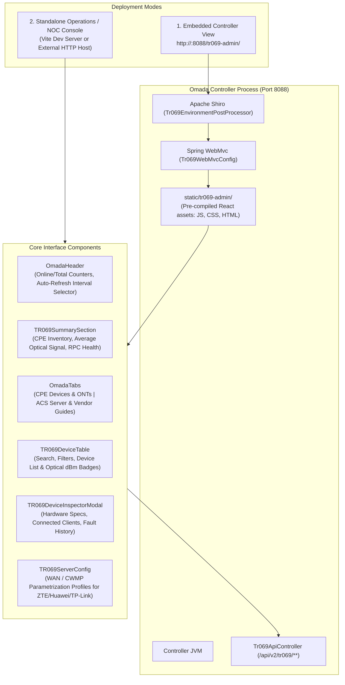

# Dedicated TR-069 / CWMP Operations Dashboard (`tr069-ui`)

An independent research dashboard designed for operational administration, real-time optical telemetry diagnostics, and remote provisioning of **CWMP / TR-069 devices (broadband CPEs, GPON ONTs, and gateways)**.

The frontend is constructed using **React 19, TypeScript, and Vite**, leveraging the **Lucide Icons** vector library and a decoupled service client for communication with the controller's embedded ACS REST endpoints (`/api/v2/tr069/**`).

---

## 1. Architecture and Operational Modes

The `tr069-ui` console supports two complementary operational deployments:



### 1.1. Embedded Controller Deployment (`/tr069-admin/**`)
- Compiled production assets (`index.html`, content-hashed JS and CSS bundles) are packaged within the backend Java JAR under `src/main/resources/static/tr069-admin/`.
- The Spring `WebMvcConfigurer` (`Tr069WebMvcConfig`) routes `/tr069-admin/**` to serve these resources directly from the application classpath.
- Early Shiro environment rules (`Tr069EnvironmentPostProcessor`) grant anonymous access before the host's unmapped path drop rule (`RejectFilter`).

### 1.2. Standalone NOC Dashboard Deployment
- The console can run independently via the Vite development server (`npm run dev`) or on a dedicated monitoring display station.
- HTTP requests are directed to the controller's `/api/v2/tr069/**` endpoints via standard CORS / reverse-proxy configuration.

---

## 2. Component Hierarchy and Telemetry Flow

### 2.1. Operational Header (`OmadaHeader.tsx`)
- Provides visual parity with the controller's native header styling.
- Real-time counters showing online device ratio (active / total).
- Configurable auto-refresh interval (5s, 10s, 30s, or 60s) with live indicator animation.
- Manual refresh trigger with spinning reload feedback.

### 2.2. Metric Summary Section (`TR069SummarySection.tsx`)
Aggregates high-level telemetry computed across the active inventory:
- **Total Registered CPEs**: Total count of managed hardware units in the database.
- **Online Devices**: CPEs that emitted a valid CWMP `Inform` within their active heartbeat window.
- **Average Optical Rx Power**: Fleet-wide average of GPON BOSA/SFP optical reception levels.
- **RPC Success Rate**: Percentage of completed remote procedure executions without SOAP faults.

### 2.3. Device Inventory Table (`TR069DeviceTable.tsx`)
- **Multi-Field Search**: Real-time filtering by MAC address, serial number, manufacturer, model name, and IP address.
- **Status Filters**: Quick views for *Online*, *Offline*, and *Critical Optical Signal*.
- **Optical Signal Badges**:
  - `Normal` (Green): Rx power between `-15 dBm` and `-24 dBm`.
  - `Warning` (Amber): Rx power between `-25 dBm` and `-27 dBm`.
  - `Critical` (Red): Rx power `< -28 dBm` (high risk of fiber link drop).
- **Inline Action Controls**:
  - Immediate Connection Request dispatch (port 7547 trigger).
  - Remote hardware reboot command scheduling.
  - Deep inspection modal launcher.

### 2.4. Detailed Device Inspector (`TR069DeviceInspectorModal.tsx`)
Tabbed inspection modal providing comprehensive hardware analysis:
1. **Hardware Overview**: Vendor, model, hardware revision, firmware build, system uptime, serial number, and Connection Request URL.
2. **Network Parameters**: WAN IP, subnet mask, default gateway, DNS servers, and MAC address.
3. **GPON Optical Telemetry**: Rx/Tx optical power levels, laser bias current, module operating temperature, and internal supply voltage.
4. **Connected Client Stations**: Station table listing devices connected to the CPE's LAN ports or Wi-Fi radios (IP, MAC, hostname, and Tx/Rx byte counters).
5. **Command Execution Queue**: Real-time log of scheduled, in-progress, and completed RPC jobs along with reported SOAP fault codes.

### 2.5. Vendor Profile Guides (`TR069ServerConfig.tsx`)
Standardized CWMP provisioning profiles and parameter paths for common enterprise ONTs:
- **ZTE** (ZXHN F670L, F680, F6600P): ACS URL configuration, connection request credentials, and periodic inform intervals.
- **Huawei** (EchoLife HG8145V5, HG8245H): Web UI and OLT profile parameter settings.
- **TP-Link** (Archer, EX220, XC220-G3v): Built-in CWMP activation and STUN settings.

---

## 3. Backend REST Service Client (`services/api.ts`)

HTTP communication is abstracted in a dedicated service layer:

```typescript
const BASE_URL = '/api/v2/tr069';

export const tr069Api = {
  async listDevices(): Promise<{ total: number; data: Tr069Device[] }> {
    const res = await fetch(`${BASE_URL}/devices`);
    if (!res.ok) throw new Error(`Failed to fetch devices: ${res.statusText}`);
    return res.json();
  },

  async getMetrics(): Promise<Tr069Metrics> {
    const res = await fetch(`${BASE_URL}/metrics`);
    if (!res.ok) throw new Error(`Failed to fetch metrics: ${res.statusText}`);
    return res.json();
  },

  async triggerConnectionRequest(mac: string): Promise<{ success: boolean; message: string }> {
    const res = await fetch(`${BASE_URL}/devices/${mac}/connection-request`, {
      method: 'POST',
    });
    if (!res.ok) throw new Error(`Connection request failed: ${res.statusText}`);
    return res.json();
  },

  async reboot(mac: string): Promise<{ success: boolean; message: string }> {
    const res = await fetch(`${BASE_URL}/devices/${mac}/reboot`, {
      method: 'POST',
    });
    if (!res.ok) throw new Error(`Reboot schedule failed: ${res.statusText}`);
    return res.json();
  },
};
```

---

## 4. Directory Structure

```
tr069-ui/
├── public/                       # Static public assets and favicons
├── src/
│   ├── components/               # Modular UI component tree
│   │   ├── OmadaHeader.tsx       # Operational header with refresh controls
│   │   ├── OmadaTabs.tsx         # Primary view tabs
│   │   ├── TR069DeviceInspectorModal.tsx # Deep inspection dialog
│   │   ├── TR069DeviceTable.tsx  # Searchable, filterable device grid
│   │   ├── TR069ServerConfig.tsx # Vendor-specific provisioning documentation
│   │   └── TR069SummarySection.tsx # Fleet-wide metric summary cards
│   ├── services/
│   │   └── api.ts                # HTTP client for /api/v2/tr069 endpoints
│   ├── types/
│   │   └── tr069.ts              # TypeScript interfaces (Device, Telemetry, RPC)
│   ├── App.tsx                   # Root application container
│   ├── index.css                 # Global styles and layout rules
│   └── main.tsx                  # React 19 entry point
├── index.html                    # Vite HTML template
├── package.json
├── tsconfig.json
└── vite.config.ts                # Build configuration with base path /tr069-admin/
```

---

## 5. Build and Output Configuration

The Vite configuration outputs directly into the Spring Boot backend's static resource directory:

```typescript
// vite.config.ts
import { defineConfig } from 'vite';
import react from '@vitejs/plugin-react';

export default defineConfig({
  plugins: [react()],
  base: '/tr069-admin/',
  build: {
    outDir: '../src/main/resources/static/tr069-admin',
    emptyOutDir: true,
  },
});
```

To compile production assets:
```bash
cd tr069-ui
npm install
npm run build
```
Once generated, standard Gradle packaging in the parent directory (`./gradlew build`) bundles the static assets into the final backend JAR.
